<h1 align="center">Тимур Турдыев</h1>

  В разработке с 2014 года — от legacy PHP 5.6 до современного TypeScript и Go-микросервисов. 
  Ко всему пришёл сам. Стараюсь выбирать инструмент под задачу, а не наоборот.

  

  
  
  
  
  
  

---

### 👋 Немного обо мне

Пишу код **с 2014 года**. Профильного образования не получал — всему научился сам: по документации, форумам, чужому коду и собственным ошибкам. Этот путь дольше, чем курсы или университет, но он приучил не запоминать «как правильно», а каждый раз разбираться, **почему** так.

**В разработку пришёл не с нуля.** Сначала был свой **интернет-магазин** — я вёл его как владелец, и узнал e-commerce со стороны денег: воронка, выгрузки, возвраты, маркетплейсы, «небольшой баг в корзине = потерянный заказ». Потом был период **SEO**: техническая оптимизация, скорость, индексация, разметка, аналитика. К моменту, когда я начал писать код, я уже хорошо понимал, **что** нужно бизнесу и **где** именно он теряет деньги — оставалось научиться это чинить руками.

Поэтому первой платформой стал **OpenCart**: я знал её изнутри как владелец магазина и как оптимизатор, и было естественно начать писать под неё модули. Долго брал заказы на **русскоязычном форуме OpenCart** — по магазинам, интеграциям, миграциям. Со временем заказы почти перестали приходить из открытых площадок: клиенты начали **рекомендовать меня друг другу**, и большая часть проектов пошла по сарафанному радио.

Этот опыт научил двум главным вещам, которые я ценю до сих пор:

- **Код должен работать у клиента без меня.** Когда клиент — не программист, ты не можешь оставить за собой «тут надо знать, как это собирать». Всё должно просто запускаться, обновляться и чиниться в понятных местах.
- **Рекомендации — лучший KPI.** Когда человек приводит к тебе своего знакомого, это значит, что предыдущий проект не доставил ему боли. Это дисциплинирует сильнее любого код-ревью.

Сейчас работаю в продуктовой разработке Waviot.

---

### 🎯 Как я работаю

> Стараюсь не применять технологии ради технологий.
> Новый фреймворк сам по себе не делает продукт лучше — его делают лучше правильные решения в нужных местах.

- 🧠 **Инженерное суждение важнее стека.** На проде — стабильный, проверенный стек; эксперименты — в пет-проектах. SPA-фреймворк не появится в проекте, где хватает Alpine или чистого JS. jQuery не будет удалён из работающего legacy ради «моды».
- 🔁 **Одинаково уверенно работаю и со старым, и с новым кодом.** Читаю чужой legacy без фреймворка, поддерживаю Yii2 и Laminas, пишу современный TypeScript — и всё это может жить в одной компании одновременно.
- 🛠️ **Большой опыт миграций и апгрейдов.** Переводил проекты с **Zend Framework на Laminas**, поднимал **PHP с 5.6 до актуальных версий**, обновлял **Yii**, переводил поиск на **SphinxSearch** и обратно под задачу. Знаю, где у таких переходов подводные камни.
- 🪓 **Не применяю язык/фреймворк там, где это не нужно.** Иногда правильный ответ — это shell-скрипт, yoyo-миграция, bash-cron или одна SQL-вьюха вместо целого сервиса.
- 🧩 **Сильная сторона — связывать системы.** CRM, АТС, службы доставки, сервисы данных, IoT-устройства — моя специализация в интеграциях, где важно не сломать работающее.
- ♻️ **Лучший код — тот, который легко удалить.** Пишу так, чтобы через год можно было выкинуть кусок без страха за остальное.

---

### 💼 Опыт на боевых системах

В **[@waviot](https://waviot.ru)** (IoT-платформа на протоколе NB-Fi) веду и развиваю системы на очень разных стеках — осознанно, потому что у каждой части свой контекст и свой возраст:

| Слой | Стек | Почему так |
| --- | --- | --- |
| Личный кабинет клиентов | **TypeScript + Vue + Vite + Tailwind** | Свежий проект — можно позволить современный SPA |
| Основные сервисы биллинга/лицензий | **Laravel (PHP)** | Экосистема, скорость разработки, проверено временем |
| Сервис лицензирования (legacy) | **Yii2 + Codeception + RBAC** | Работает стабильно, переписывать без причины — дорого |
| Высоконагруженная авторизация | **Go** | Там, где PHP избыточен: низкая латентность, бинарник |
| Очереди и шина между сервисами | **RabbitMQ + AMQP** | Развязка сервисов: отказ одного не роняет остальных, нагрузка сглаживается очередью |
| Телефония / callbacks | **Python** | Хорошие библиотеки под конкретные задачи |
| Сервер производства (legacy) → новый | **Python → сейчас переписываю** | Старый сервер работает, новый пишу параллельно без простоя |
| Поиск по большим каталогам | **SphinxSearch** | Когда нужна полнотекстовая выборка с предсказуемой скоростью |
| Миграции версий PHP и фреймворков | **PHP 5.6 → 8.x, Zend → Laminas, Yii upgrade** | Переводил несколько проектов на актуальные версии без downtime |
| Desktop-утилиты для инженеров | **Go + Wails** | Нужен кроссплатформенный бинарник без Electron-веса |
| Legacy отчёты и старые модули | **PHP (self-made MVC, PHTML)** | Не трогаем то, что работает — если трогаем, то точечно |
| Поиск и аналитика нового поколения | **Meilisearch + Docker** | Правильный инструмент под новую задачу поиска |

Мне интересно не столько «писать на чём-то одном», сколько понимать, **когда** какой стек уместен — и уметь жить сразу с несколькими поколениями кода в одном проекте.

---

### 🛠️ С чем работаю

**Языки** — PHP (8+), JavaScript / TypeScript, Go, Python, Java, Bash

**Backend-фреймворки** - Laravel (+ MoonShine для быстрых админок) · Yii2 · **Laminas (бывший Zend Framework)** · OpenCart · самописный MVC (legacy) · Go (чистый) · Python (серверные приложения · FastAPI · aiohttp)

**Frontend** — TypeScript · Vue · Alpine.js · Blade · **jQuery** (да, знаю, когда он уместен) · Tailwind · Bootstrap · Vite · Electron · Wails

**БД и поиск** — MySQL · MariaDB · PostgreSQL · SQLite · MongoDB · Redis · **SphinxSearch** · **Manticore** · Meilisearch

**Очереди и шина** — RabbitMQ · AMQP

**Инфраструктура** - Docker · **Ansible** (роль на каждый предмет - nginx, PHP-FPM, MariaDB, Manticore, imgproxy, очереди, бэкапы; секреты в Vault, повторный прогон даёт `changed=0`, приёмка отдельным плейбуком, полигон той же ОС) · Deployer · **Ubuntu/Debian-серверы** (systemd-юниты, deb-пакеты, сторонние репозитории, sysctl, бэкапы) · **Bash** (скрипты эксплуатации и деплоя) · Nginx · Git · cron/yoyo/fabric для старых деплоев

**Интеграции** — Mango Office · Megaplan · Dadata · СДЭК · ВКонтакте API · OpenCart marketplace API

  
  
  
  
  
  
  
  
  
  
  
  
  
  
  
  
  
  
  
  
  
  
  
  
  
  

---

### 🚀 Что строю сейчас — Mercurio Platform

**[Mercurio](https://github.com/mercurioplatform)** - мой проект: платформа для интернет-магазинов - админка, CMS и витрина в одном приложении на **Laravel 13 + Blade + Bootstrap 5 + jQuery** (PHP 8.4). Стек выбран намеренно: серверный рендер с точечным AJAX - та же идея, что у **Hotwire, HTMX и Laravel Livewire**, только без новой обучающей кривой поверх и так знакомых инструментов. Новый раздел админки добавляется одним классом, без отдельного SPA-приложения сбоку и build-цепочки на пустом месте.

Фасетный поиск по каталогу витрины сделан **на самой MariaDB**, без отдельного поискового движка: для магазина такого размера это меньше движущихся частей при том же результате.

Это сборка всех трёх «прошлых жизней» в одном продукте — владельца магазина, SEO-специалиста и full-stack-разработчика: сделать админку, в которой удобно тем, кто **реально продаёт**, а не «настраивает CRM».

**Состав админки**

| Раздел | Что внутри |
| --- | --- |
| 📦 **Каталог** | Товары · Категории · Бренды · Атрибуты · Группы · Варианты · Опции · Изображения |
| 🛒 **Продажи** | Заказы · Возвраты (RMA) |
| 👥 **Клиенты / CRM** | Клиенты · Задачи · Диалоги · Быстрые ответы · Сегментация |
| 📣 **Маркетинг** | Промокоды · Брошенные корзины · Отзывы |
| 📝 **Контент** | Блог · Страницы · Медиа |
| 🏬 **Склад** | Остатки · Движения · Перемещения · Приходы (многоскладовость) |
| 📊 **Аналитика** | Когорты · LTV |
| ⚙️ **Сервис** | Импорт CSV (с прогрессом и кэшем картинок) · Audit log |
| 🔧 **Настройки** | Контакты · Доставка · Оплата · Почта · API + Webhooks |
| 🛡️ **Команда** | Пользователи · Роли и права |

Куски платформы, которые оказались полезны сами по себе, я выношу в отдельные пакеты и выкладываю в open-source — они собраны [в секции ниже](#-open-source-пакеты).

---

### 📦 Open-source пакеты

Выношу наружу только то, что уже отработало в боевом проекте и понадобилось во втором, — поэтому здесь нет «фреймворков ради фреймворков». Всё ниже написано мной: и то, что под ником, и то, что под организацией [`mercurioplatform`](https://github.com/mercurioplatform) — она тоже моя.

| Пакет | О чём | Стек |
| --- | --- | --- |
| 📋 [mercurioplatform/tables](https://github.com/mercurioplatform/tables)   | List/table-движок для Laravel-админок: декларативный `Resource`-класс → страница с поиском, сортировкой, фильтрами, saved views, bulk/row actions, экспортом, prefs и audit log — одной строкой роута | PHP · Laravel · Bootstrap 5 · jQuery · Blade |
| ⚙️ [timurturdyev/simple-settings](https://github.com/TimurTurdyev/Simple-Settings)   | Key-value настройки для Laravel: группы, кэш, автоприведение типов, атомарная пакетная запись | PHP 8.2+ · Laravel 12/13 |
| 🐍 [simple-db-settings](https://github.com/TimurTurdyev/simple-settings-py)   | Тот же менеджер настроек для Python на SQLAlchemy 2 — **совместим по таблице с PHP-версией**: сервисы на Laravel и на Python читают и пишут одни и те же настройки | Python · SQLAlchemy 2 · pydantic |
| 🛒 [timurturdyev/simple-cart](https://github.com/TimurTurdyev/simple-cart)   | Корзина, закладки и сравнение — один примитив с политикой из конфига. Деньги считает только корзина, через конвейер классов-корректировок: без float и без обязательных миграций | PHP 8.3+ · Laravel 12/13 |
| 🔎 [timurturdyev/simple-seo](https://github.com/TimurTurdyev/simple-seo)   | Meta, Open Graph, карточки Twitter/X и JSON-LD. Ядро без зависимостей, слой Laravel — в том же пакете. Замена `artesaos/seotools`: дефолты не «липнут» к странице, JSON-LD собирается коллекцией в `@graph` | PHP 8.2+ · Laravel 11/12 |

> `tables`: 5 сознательных точек расширения, страница рендерится сервером, AJAX подгружает только `<x-tables::table-root>`. 
> `simple-seo` и `simple-cart` написаны **с нуля** на замену `artesaos/seotools` и `darryldecode/laravelshoppingcart` в своих проектах: от старых пакетов взята только идея, реализация и API свои — общего кода нет. Оба выросли из e-commerce-практики, а не из желания сделать ещё один пакет.

---

### 📌 Публичные проекты

Коммерческий код закрыт под NDA — здесь то, что можно показать: модули, SDK, утилиты и эксперименты.

| Проект | О чём | Стек |
| --- | --- | --- |
| 📞 [Laravel-Mango-Office](https://github.com/TimurTurdyev/Laravel-Mango-Office) | Интеграция Laravel с облачной АТС Mango Office | PHP · Laravel |
| 📦 [Export-Import-Opencart-Vue](https://github.com/TimurTurdyev/Export-Import-Opencart-Vue) | Импорт/экспорт товаров OpenCart с Vue-интерфейсом | PHP · Vue |
| 📍 [opencart-dadata](https://github.com/TimurTurdyev/opencart-dadata) | Подсказки адресов/ФИО от Dadata в OpenCart | Vue · PHP |
| 🧹 [opencart-image-remover](https://github.com/TimurTurdyev/opencart-image-remover) | Чистка каталога изображений OpenCart от «осиротевших» файлов | PHP |
| 🚚 [migration-opencart-database-to-new-version](https://github.com/TimurTurdyev/migration-opencart-database-to-new-version) | Миграции БД между версиями OpenCart | PHP |
| 📡 [NB-Fi-platform](https://github.com/TimurTurdyev/NB-Fi-platform) | LPWAN IoT-платформа на протоколе NB-Fi | PHP |
| 🛰️ [my-tools-parse-message-waviot](https://github.com/TimurTurdyev/my-tools-parse-message-waviot) | Десктопный парсер сообщений WAVIOT API — личная утилита для инженеров | Wails · Vue 3 · Tailwind 4 |
| 📊 [Dashboard-Megaplan-and-Mangooffice](https://github.com/TimurTurdyev/Dashboard-Megaplan-and-Mangooffice) | Отчёты по менеджерам из Megaplan + Mango Office | PHP |
| 🔗 [sdk2.0](https://github.com/TimurTurdyev/sdk2.0) (форк) | PHP SDK для API v2.0 сервиса СДЭК — форк официального `cdek-it/sdk2.0`, держу под свои интеграции | PHP |
| 📈 [simple-settings-benchmark](https://github.com/TimurTurdyev/simple-settings-benchmark) | Голый Laravel-стенд: замеры производительности пакета Simple-Settings | PHP · Laravel · Blade |
| 🖼️ [transfer-images](https://github.com/TimurTurdyev/transfer-images) | Перенос папки с изображениями между серверами | Shell |
| 🛜 [vpn-help](https://github.com/TimurTurdyev/vpn-help) | Восстановление интернета на macOS при конфликте OpenVPN и AmneziaVPN | Shell · macOS |

> Основная работа над коммерческими продуктами — во внутреннем GitLab Waviot.

---

### 📬 Контакты

  
  
  

  💡 Открыт к <b>интересным инженерным задачам</b> — особенно где нужно связать системы, разобраться в чужом коде или принять инженерное решение, а не просто «накодить фичу».

